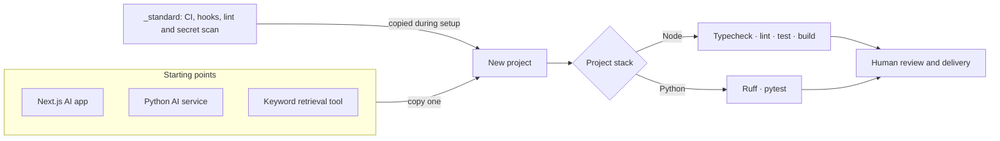

# AI Starter

Three copyable starting points for AI applications: a Next.js web app, a Python
CLI/service, and a local keyword retrieval tool. Each includes CI, tests, security
guidance and configuration copied from a shared engineering standard.


## Templates

### Choose a template

| Template | Choose it for |
| --- | --- |
| [Next.js AI app](templates/ai-next-app/) | An AI web interface using Next.js, React, TypeScript and the Vercel AI SDK. |
| [Python AI service](templates/ai-python-service/) | A Python CLI or service starting point using Pydantic AI and uv. |
| [Keyword retrieval tool](templates/ai-rag-tool/) | Searching local documents by keyword and returning excerpts with source references. No embeddings or vector database. |

### What's included

| Included | Next.js app | Python service | Keyword retrieval |
| --- | --- | --- | --- |
| Starting implementation | Chat page and API route | Model-calling CLI | Document loading, keyword ranking and source references |
| Prompt files and JSONL smoke fixtures | Yes | Yes | Yes |
| Tests | Vitest | pytest | pytest |
| Static checks | TypeScript and Biome | Ruff lint and format | Ruff lint and format |
| Copied CI, pre-push hook, secret scan, `.env.example` and security guidance | Yes | Yes | Yes |

Smoke fixtures are starter cases, not scored model evaluations. See
[evaluation coverage and limits](docs/evals-baseline.md).

## How it fits together

Templates are copied into a new project. The shared standard is maintained in
this repository and copied into generated projects; there is no runtime shared
package or project generator.



Templates include deterministic checks for local use and CI. Pre-push hooks run
a subset of CI checks; see Quality gates below.

The optional [local AI reviewer](docs/standing-reviewer.md) is **advisory, not a
merge gate**. It uses the existing [human-owned rubric](docs/review-rubric.md):
claims match reality, meaningful tests, security, no secrets, spec adherence and
honest documentation. A human makes the final merge decision.

## Try a template

Each demo copies one template and runs its full CI checks without calling a
model. Run each block from this repository's root, using an unused destination.
The template READMEs describe how to run the applications and configure providers.

### Python service demo

Requires Python 3.12+ and uv:

```bash
cp -R templates/ai-python-service ../my-ai-service
cd ../my-ai-service
uv sync --dev &&
uv run ruff check . &&
uv run ruff format --check . &&
uv run pytest
```

### Next.js app demo

Requires Node 24 and pnpm 11:

```bash
cp -R templates/ai-next-app ../my-ai-app
cd ../my-ai-app
pnpm install --frozen-lockfile &&
pnpm typecheck && pnpm lint && pnpm test && pnpm build
```

### Keyword retrieval demo

Requires Python 3.12+ and uv. Its smoke tests create temporary Markdown sources
and exercise keyword retrieval and source references:

```bash
cp -R templates/ai-rag-tool ../my-retrieval-tool
cd ../my-retrieval-tool
uv sync --dev &&
uv run ruff check . &&
uv run ruff format --check . &&
uv run pytest
```

## Quality gates

At the repository root, run `node --test "tests/**/*.test.mjs"` for the reviewer
unit tests and repository secret scan. Root CI runs this suite on pull requests
and pushes to `main`; it does **not** run the three template suites.

Each copied template includes its own CI workflow and pre-push hook. After
installing dependencies as shown above, run its checks from the copied project:

| Template | Full CI checks |
| --- | --- |
| Next.js app | `pnpm typecheck && pnpm lint && pnpm test && pnpm build` |
| Python service | `uv run ruff check . && uv run ruff format --check . && uv run pytest` |
| Keyword retrieval | `uv run ruff check . && uv run ruff format --check . && uv run pytest` |

Each template's test command includes its pattern-based secret scan. Next.js
pre-push runs typecheck and tests; Python pre-push runs Ruff lint and pytest.
Hooks require activation and can skip when tooling is unavailable. See the
[setup and inheritance checklist](docs/project-generation.md).

These checks require no live model or API key and do not establish model response
quality. The [local verification script](docs/verify-all.md) runs a subset of
these checks; it does not replace the full commands above.

## When not to use this

- You need authentication, payments, a database or deployment configuration already integrated.
- You need semantic retrieval, embeddings or a vector database out of the box.
- You need measured model quality or production-readiness guarantees.
- You need centrally managed updates: copied projects own their files, and changes here do not propagate automatically.

## License

The original project and template files are licensed under the MIT License.
Each template carries its own copy of the license so it remains with a copied
template. Third-party dependencies retain their own licenses; this repository
does not bundle their installed packages.
