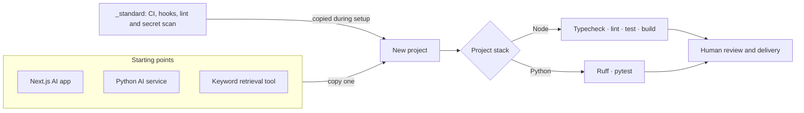

# AI Starter

Three practical templates for building AI applications, with consistent
engineering checks built into each starting point.


## Templates

- **[Next.js AI app](templates/ai-next-app/)** — Next.js, React, TypeScript,
  Vercel AI SDK, Tailwind, and Vitest.
- **[Python AI service](templates/ai-python-service/)** — a small CLI/service
  starter using Pydantic AI, `uv`, Ruff, and pytest.
- **[Keyword retrieval tool](templates/ai-rag-tool/)** — local document loading,
  keyword matching, and source citations; it does not include embeddings or a
  vector database.

Each template includes prompts, smoke evaluations, tests, example environment
configuration, and security guidance.

## How it fits together

Templates are copied into a new project. The shared standard is maintained in
this repository and copied into generated projects; there is no runtime shared
package or project generator.



The checks are deterministic and run locally and in the generated project's CI.
The optional local AI reviewer provides suggestions; it is not a merge gate.

## Try a template

For example, copy the Python service and run its checks:

```bash
cp -R templates/ai-python-service ../my-ai-service
cd ../my-ai-service
uv sync --dev
uv run ruff check .
uv run pytest
```

For the Next.js template, use Node 24 and pnpm 11:

```bash
cd templates/ai-next-app
pnpm install --frozen-lockfile
pnpm typecheck && pnpm lint && pnpm test && pnpm build
```

## Verification

The repository's CI runs the unit suite and its secret scan on pushes and pull
requests. Each template also defines the checks that its generated project
inherits. Run the relevant commands after changing a template.

## License

The original project and template files are licensed under the MIT License.
Each template carries its own copy of the license so it remains with a copied
template. Third-party dependencies retain their own licenses; this repository
does not bundle their installed packages.
